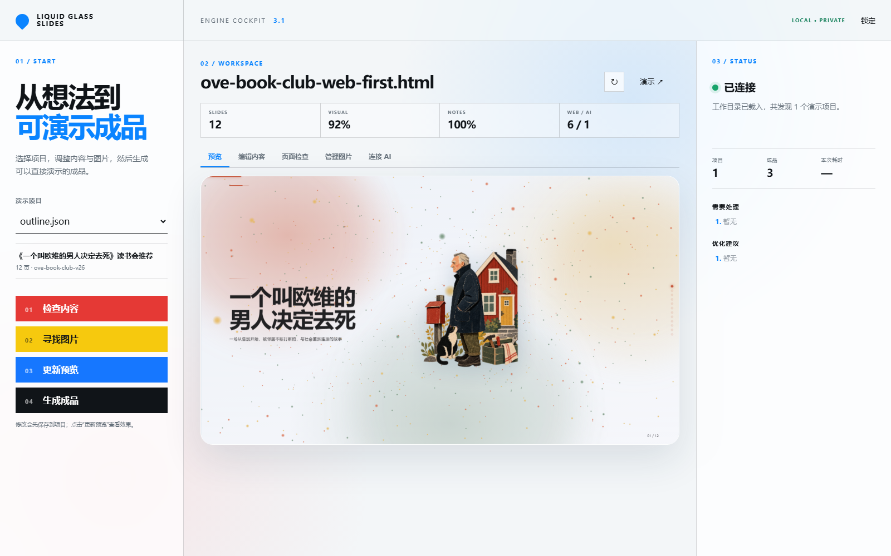
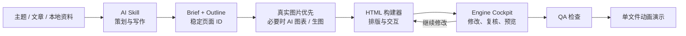

# Liquid Glass Slides

<div align="center">

**把一个主题，变成可讲、可改、可追踪来源的动画演示。**

面向 Codex、WorkBuddy、Claude、Gemini、Cursor 与其他 AI Agent 的演示文稿生成引擎。

真实图片优先，数据图表按需，最终输出一个可离线播放的自包含 HTML。

[](LICENSE)


[▶ 在线体验完整演示](https://lll192.github.io/liquid-glass-slides/) · [快速开始](#windows最快开始) · [连接 AI](#让-ai-使用这个工具)

</div>

[](https://lll192.github.io/liquid-glass-slides/)

> 点击上图或“在线体验完整演示”，即可在浏览器中直接播放完整成品；支持键盘方向键、滚轮、触摸翻页以及 `F` 全屏。

## 这不是一套固定模板

`liquid-glass-slides` 是一条完整的演示生产流水线：AI 负责策划、写作与视觉决策；确定性的构建器负责排版、交互、校验和输出；用户通过 Engine Cockpit 修改内容、管理图片、检查问题并重新生成。



### 核心能力

- **模型无关**：一套 `SKILL.md` 与 CLI，可被不同 AI 平台调用。
- **真实图片优先**：先通过 Google、Pinterest 等发现候选，再回到图片原始来源核验版权与下载；无法满足表达时才使用 AI 生图。
- **视觉角色明确**：每页最多 1 张全屏背景图、3 张内容图；不再提供“装饰图”选项。
- **自动选择版式**：根据文字量、图片数量与横竖比例选择分栏、画廊或全幅背景，避免重复叠图。
- **数据可视化**：出现明确统计、趋势或比较数据时，可用 ECharts 图表取代普通配图。
- **可编辑演讲者笔记**：播放时按 `N` 打开演讲者面板，编辑后保存在本机浏览器；观众端不会看到。
- **稳定项目协议**：`deck_id`、`slide_id`、媒体清单和流水线状态让另一个 AI 可以接手同一项目。
- **浏览器级 QA**：检测文字溢出、边界越界、字号过小、视觉缺失与来源缺失。

## 真实生成效果

下面两张图来自同一个《一个叫欧维的男人决定去死》读书会项目，不是设计稿或界面模型。

**[打开 12 页完整在线演示 →](https://lll192.github.io/liquid-glass-slides/)**

| 封面：克制的玻璃层次与瑞典叙事气质 | 内容页：真实摄影、强层级与清晰比较 |
|---|---|
|  |  |

默认视觉方向不是“满屏玻璃卡片”，而是：**瑞士网格 + 构成主义的不对称关系 + 大尺度中文标题 + 单一强调色 + 克制的 Liquid Glass 信息层**。玻璃用于组织信息，不作为无意义装饰。

## 图片策略

生成器按“真实世界素材优先”的顺序工作：

1. 使用 Google、Pinterest 或开放图库发现合适的真实摄影候选。
2. 回到原始网页确认来源、作者和许可，不把搜索结果缩略图直接写进成品。
3. 横向、接近 16:9 且尺寸足够的图片优先作为背景图；背景图每页最多 1 张，可调不透明度并全屏铺展。
4. 竖向或方形图片作为内容图；每页最多 3 张，由引擎结合文字密度自动排版。
5. 除首尾页外，每页至少有一张有效图片，或在确有数据时使用图表替代。
6. 同一张图片在同一页只能承担一种角色。没有必要时不生图，也不添加纯装饰图片。

> Google 与 Pinterest 用于发现线索，不等于图片已经获得复用授权。公开发布前仍需核验原始来源和许可。

## Windows：最快开始

从 GitHub 下载并解压后，在 Windows 文件资源管理器中双击：

```text
打开控制台.cmd
```

首次运行会检查 Python、安装本地 Skill 并打开 Engine Cockpit。关闭同时出现的命令窗口即可停止本地服务。若双击后只看到代码，请确认是在**文件资源管理器**中运行，而不是在编辑器或聊天附件预览里打开。

### 打开已有演示

控制台读取的是“演示项目文件夹”，不是单独的 HTML。项目文件夹中通常包含：

```text
my-project/
├── brief.json
├── outline.json
├── media-manifest.json
└── dist/
    └── my-project.html      # 最终展示文件
```

将控制台的工作目录指向包含 `outline.json` 的项目目录，即可继续编辑；最终 HTML 位于该项目的 `dist/` 文件夹。

## 让 AI 使用这个工具

### Codex

```powershell
git clone https://github.com/lll192/liquid-glass-slides.git
cd liquid-glass-slides
python scripts/install_plugin.py --target codex
```

重启 Codex 后直接说：

```text
使用 liquid-glass-slides，根据这份资料生成 12 页演示；真实图片优先，完成后运行检查。
```

### WorkBuddy 或支持 Skill 的 AI

让 AI 克隆或打开本仓库，并明确要求它完整读取根目录的 `SKILL.md`，然后在你的演示项目目录中工作。若平台支持自定义 Skill 目录，可运行：

```powershell
python scripts/install_plugin.py --target custom --destination "C:\你的AI工具\skills"
```

### MCP 客户端

MCP 适合希望让 AI 在对话中直接调用“检查项目、构建、管理媒体、修改页面”等工具的用户：

```powershell
python scripts/mcp_server.py --workspace "C:\你的演示项目目录"
```

客户端配置与安全边界见 [`references/mcp-server.md`](references/mcp-server.md)。不支持 MCP 也没关系：AI 仍可直接运行统一 CLI。

## CLI 工作流

```powershell
# 检查运行环境
python scripts/slides.py --json doctor

# 校验演示结构
python scripts/slides.py --json validate outline.json

# 运行完整生产流水线
python scripts/slides.py --json run --outline outline.json --out dist/deck.html

# 查看任务状态
python scripts/slides.py --json status dist/deck.pipeline-state.json
```

流水线会生成故事板、视觉规划、内容导演报告、QA 报告、任务状态和最终 HTML。失败时会记录精确阶段，修正后可以继续，而不必从头生成。

## 项目结构

```text
liquid-glass-slides/
├── SKILL.md                  # AI 必须遵循的完整生产工作流
├── AGENTS.md / CLAUDE.md     # 不同 Agent 的仓库入口
├── assets/                   # 播放引擎、主题令牌与内置库
├── console/                  # Engine Cockpit 前端
├── templates/                # 页面骨架与布局组件
├── references/               # 图片、构图、MCP、API 等规范
├── scripts/
│   ├── slides.py             # 统一 CLI
│   ├── build.py              # HTML 构建器
│   ├── agent_service.py      # CLI / MCP / HTTP 共用服务
│   ├── mcp_server.py         # MCP stdio 服务
│   └── api_server.py         # 本地 API 与控制台服务
└── tests/                    # 协议、构建、视觉规则与 API 测试
```

## 面向其他平台的入口

| 平台 | 入口 |
|---|---|
| WorkBuddy / Skill-compatible agents | `SKILL.md` |
| OpenAI Codex | `AGENTS.md` 或安装后的 `SKILL.md` |
| Claude Code | `CLAUDE.md` |
| Gemini CLI | `GEMINI.md` |
| Cursor | `.cursor/rules/liquid-glass-slides.mdc` |
| 其他 AI Agent | `references/INSTRUCTIONS.md` + `scripts/slides.py` |

## 开发与验证

核心构建链只依赖 Python 标准库。运行完整测试：

```powershell
python -m unittest discover -s tests -v
```

## English

Liquid Glass Slides is a model-agnostic presentation production engine for AI agents. It turns a topic, article, notes, or local source files into a self-contained animated HTML deck, while keeping the brief, outline, media provenance, presenter notes, QA results, and pipeline state editable and traceable.

Its visual system combines Swiss-grid discipline, constructivist asymmetry, editorial typography, real-world photography, and restrained Liquid Glass surfaces. Web imagery is discovered first and verified at its original source; each slide supports one full-bleed background or up to three content images. Decorative-image roles have been retired. Quantitative slides can use ECharts, and AI imagery fills only genuine visual gaps.

Use `打开控制台.cmd` on Windows, install the Skill with `python scripts/install_plugin.py --target codex`, or connect an MCP client with `python scripts/mcp_server.py --workspace <project-directory>`.

## License

[MIT](LICENSE) © 2026 lll192
