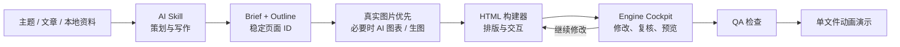

# Liquid Glass Slides

<div align="center">

**把一个主题，变成可讲、可改、可追踪来源的动画演示。**

面向 Codex、WorkBuddy、Claude、Gemini、Cursor 与其他 AI Agent 的演示文稿生成引擎。

真实图片优先，数据图表按需，最终输出一个可离线播放的自包含 HTML。

[](LICENSE)


[▶ 在线体验完整演示](https://lll192.github.io/liquid-glass-slides/) · [打开控制台](#如何打开并使用-engine-cockpit) · [连接 AI](#让-ai-使用这个工具)

</div>

[](https://lll192.github.io/liquid-glass-slides/)

> 点击上图或“在线体验完整演示”，即可在浏览器中直接播放完整成品；支持键盘方向键、滚轮和触摸翻页。需要全屏时使用浏览器的 `F11`。

## 按 `N` 打开演讲者提示

演讲者提示已经包含在生成的 HTML 中，默认完全隐藏，不会占用观众页面。使用方法如下：

1. 打开[在线演示](https://lll192.github.io/liquid-glass-slides/)，或双击项目 `dist/` 文件夹中的最终 HTML。
2. 先在幻灯片的空白处单击一次，让浏览器接收键盘操作。
3. 按键盘上的 `N` 键。大小写均可；如果没有反应，先切换到英文输入法再按一次。
4. 页面右侧会打开 **Narrative Director** 演讲者面板，幻灯片会自动缩到左侧，不会被面板遮住。
5. 面板上方显示当前页的核心结论和转场提示；下方“演讲者笔记”可以直接输入或修改讲稿。
6. 使用方向键、`Page Up` / `Page Down`、空格或滚轮翻页时，面板会同步切换到当前页的提示。
7. 再按一次 `N`，或点击面板右上角的 `×`，即可关闭。

也可以在演示网址末尾加上 `?notes=1`，让页面打开时直接显示演讲者面板：

```text
https://lll192.github.io/liquid-glass-slides/?notes=1
```

### 笔记如何保存

- 在演讲者面板中输入的内容会自动保存在**当前浏览器的本地存储**中，刷新页面后仍然存在。
- 它不会上传到服务器，也不会自动改写原始 HTML、`outline.json` 或其他电脑上的副本。
- 更换浏览器、使用另一台电脑或清除浏览器数据后，本地笔记不会自动带过去。
- 如果希望笔记永久写入项目和下一次生成的 HTML，请在 Engine Cockpit 的“编辑内容”中修改“演讲者笔记”，然后保存页面并重新生成。

> **投屏提醒：**`N` 面板只在按键的那个浏览器窗口中出现。但如果电脑使用“复制屏幕/镜像投屏”，观众仍会看到同一个面板。当前版本没有双窗口自动同步功能；正式演示时请不要在镜像投屏窗口中按 `N`。可在彩排时使用该面板，或在另一台不对外投屏的设备上单独打开 `?notes=1` 作为提词参考。

## 这不是一套固定模板

`liquid-glass-slides` 是一条完整的演示生产流水线：AI 负责策划、写作与视觉决策；确定性的构建器负责排版、交互、校验和输出；用户通过 Engine Cockpit 修改内容、管理图片、检查问题并重新生成。



### 核心能力

- **模型无关**：一套 `SKILL.md` 与 CLI，可被不同 AI 平台调用。
- **真实图片优先**：先通过 Google、Pinterest 等发现候选，再回到图片原始来源核验版权与下载；无法满足表达时才使用 AI 生图。
- **视觉角色明确**：每页最多 1 张全屏背景图、3 张内容图；不再提供“装饰图”选项。
- **自动选择版式**：根据文字量、图片数量与横竖比例选择分栏、画廊或全幅背景，避免重复叠图。
- **数据可视化**：出现明确统计、趋势或比较数据时，可用 ECharts 图表取代普通配图。
- **可编辑演讲者笔记**：播放时按 `N` 打开当前窗口的演讲者面板，编辑后保存在本机浏览器；默认观众视图不显示面板。
- **稳定项目协议**：`deck_id`、`slide_id`、媒体清单和流水线状态让另一个 AI 可以接手同一项目。
- **浏览器级 QA**：检测文字溢出、边界越界、字号过小、视觉缺失与来源缺失。

## 真实生成效果

下面两张图来自同一个《一个叫欧维的男人决定去死》读书会项目，不是设计稿或界面模型。

**[打开 12 页完整在线演示 →](https://lll192.github.io/liquid-glass-slides/)**

| 封面：克制的玻璃层次与瑞典叙事气质 | 内容页：真实摄影、强层级与清晰比较 |
|---|---|
|  |  |

默认视觉方向不是“满屏玻璃卡片”，而是：**瑞士网格 + 构成主义的不对称关系 + 大尺度中文标题 + 单一强调色 + 克制的 Liquid Glass 信息层**。玻璃用于组织信息，不作为无意义装饰。

## 图片策略

生成器按“真实世界素材优先”的顺序工作：

1. 使用 Google、Pinterest 或开放图库发现合适的真实摄影候选。
2. 回到原始网页确认来源、作者和许可，不把搜索结果缩略图直接写进成品。
3. 横向、接近 16:9 且尺寸足够的图片优先作为背景图；背景图每页最多 1 张，可调不透明度并全屏铺展。
4. 竖向或方形图片作为内容图；每页最多 3 张，由引擎结合文字密度自动排版。
5. 除首尾页外，每页至少有一张有效图片，或在确有数据时使用图表替代。
6. 同一张图片在同一页只能承担一种角色。没有必要时不生图，也不添加纯装饰图片。

> Google 与 Pinterest 用于发现线索，不等于图片已经获得复用授权。公开发布前仍需核验原始来源和许可。

## 如何打开并使用 Engine Cockpit

GitHub Pages 上的在线演示用于播放和体验，是只读页面。需要修改文字、图片、笔记并重新生成成品时，要在自己的电脑上运行本地 Engine Cockpit。

### 1. 第一次启动

从 GitHub 下载并解压后，在 Windows 文件资源管理器中双击：

```text
打开控制台.cmd
```

首次运行会：

1. 检查电脑上是否有 Python 3.10 或更高版本。
2. 检查生成引擎，并安装本地 Codex Skill。
3. 创建默认项目目录：`文档\Liquid Glass Slides Projects`。
4. 启动只监听本机的服务，并自动打开 `http://127.0.0.1:8765/`。
5. 在桌面创建 `Liquid Glass Slides` 快捷方式，方便以后再次启动。

请保留启动后出现的命令窗口；它就是本地服务。关闭这个窗口，控制台也会停止。若双击后只看到代码，请确认是在 **Windows 文件资源管理器**中双击，而不是在编辑器、GitHub 网页或聊天附件预览中打开。

### 2. 把已有项目放进控制台

控制台读取的是完整“演示项目”，不是单独的 HTML。最少需要 `outline.json`；只有最终 HTML 时可以播放，但无法还原成可编辑的页面字段。

```text
my-project/
├── brief.json
├── outline.json
├── media-manifest.json
└── dist/
    └── my-project.html      # 最终展示文件
```

有两种打开方式：

**方式 A：使用默认项目目录**

1. 把整个 `my-project` 文件夹复制到 `文档\Liquid Glass Slides Projects`。
2. 启动控制台，点击页面左上区域的刷新按钮 `↻`。
3. 在左侧“演示项目”下拉框中选择对应的 `outline.json`。

**方式 B：直接打开任意项目目录**

先关闭正在运行的控制台命令窗口，再在仓库根目录打开 PowerShell，执行：

```powershell
powershell.exe -NoProfile -ExecutionPolicy Bypass -File ".\scripts\start_windows.ps1" -Workspace "C:\你的演示项目目录"
```

这里应填写包含 `outline.json` 的目录，而不是填写 `dist\xxx.html`。控制台启动后会递归寻找项目中的 outline 和成品文件。

### 3. 在控制台中修改项目

选择项目后，建议按下面的顺序操作：

| 区域 | 用途 | 操作方法 |
|---|---|---|
| **预览** | 查看当前生成效果 | 在固定 16:9 预览中检查页面；点击右上角“演示 ↗”打开独立播放窗口 |
| **编辑内容** | 修改页面文字和演讲稿 | 找到页面，修改标题、核心结论、转场提示或演讲者笔记，然后点击该页的“保存本页” |
| **页面检查** | 找到图片不足、文字过多的页面 | 优先处理标记为需要优化的页面，不必逐页猜测问题 |
| **管理图片** | 上传、取消或替换图片 | 先选择目标页面和“内容图/背景图”，拖入本地图片；背景图可调不透明度；最后点击“保存并应用图片” |
| **连接 AI** | 让 Codex、Claude、Cursor 等继续修改 | 普通用户复制“交给 AI 的任务”；支持 MCP 的客户端再展开高级配置 |

左侧四个生产按钮分别表示：

1. **检查内容**：只做结构和内容检查，速度最快，不生成新 HTML。
2. **寻找图片**：仅在项目已经配置图片计划时使用；普通用户也可以跳过，直接在“管理图片”中上传本地图片。
3. **更新预览**：快速重新构建 HTML。修改文字或图片后先点这里查看效果。
4. **生成成品**：运行完整生产流程，生成故事板、视觉计划、报告和最终 HTML。

推荐的最短流程是：

```text
选择项目 → 编辑内容/管理图片 → 保存 → 更新预览 → 检查效果 → 生成成品 → 演示 ↗
```

右侧状态栏会显示操作是否完成、具体错误和优化建议。最终文件仍在项目的 `dist/` 文件夹中，控制台不会把项目上传到云端。

### 4. 常见问题

- **下拉框里没有项目：**确认工作目录中存在 `outline.json`，然后点击 `↻` 刷新。
- **只有一个 HTML：**它可以直接播放，但不能在控制台中恢复为完整项目；请保留 AI 生成时的 `outline.json` 和媒体清单。
- **修改后预览没变化：**先点击“保存本页”或“保存并应用图片”，再点击“更新预览”。
- **网页显示 127.0.0.1 无法访问：**说明本地命令窗口已经关闭；重新双击 `打开控制台.cmd`。
- **端口 8765 已被占用：**先关闭之前启动的控制台窗口，再重新运行。
- **如何停止：**关闭启动控制台时出现的命令窗口即可。

## 让 AI 使用这个工具

你不需要先理解 Skill、CLI 或 MCP。选择自己正在使用的 AI，把对应的第一段指令完整复制到它的对话框即可。仓库已经打开时，AI 会自动跳过克隆步骤。

> 这些方式要求 AI 能访问本地文件并运行命令。普通网页聊天如果没有本地工具，只能帮你写内容，不能真正生成和保存 HTML。

### Codex：复制这段

```text
请执行下面的操作，不要只告诉我步骤：克隆或打开 https://github.com/lll192/liquid-glass-slides，完整读取 AGENTS.md 和 SKILL.md，然后运行 python scripts/install_plugin.py --target codex --update 安装 Skill。完成后只告诉我“安装完成，请重启 Codex”。
```

重启 Codex 后，再发送下方的“生成演示指令”。以后不需要重复安装。

### Claude Code：复制这段

```text
请执行下面的操作，不要只告诉我步骤：克隆或打开 https://github.com/lll192/liquid-glass-slides，完整读取 CLAUDE.md 和 SKILL.md。确认你已经理解生成流程后，在这个仓库中使用该工具完成我接下来发送的演示任务。
```

### Cursor：复制这段

```text
请执行下面的操作，不要只告诉我步骤：克隆或打开 https://github.com/lll192/liquid-glass-slides 作为 Cursor 项目，完整读取 .cursor/rules/liquid-glass-slides.mdc 和 SKILL.md，然后使用该工具完成我接下来发送的演示任务。
```

### Gemini CLI：复制这段

```text
请执行下面的操作，不要只告诉我步骤：克隆或打开 https://github.com/lll192/liquid-glass-slides，完整读取 GEMINI.md 和 SKILL.md，然后使用该工具完成我接下来发送的演示任务。
```

### WorkBuddy 或其他支持 Skill 的 AI：复制这段

```text
请执行下面的操作，不要只告诉我步骤：克隆或打开 https://github.com/lll192/liquid-glass-slides，完整读取根目录的 SKILL.md，并把它作为本次演示生成的工作规则。请在本地创建完整项目和最终 HTML，不要只返回大纲或 Markdown。
```

### 生成演示指令：安装或打开仓库后发送

把方括号里的内容换成自己的需求；没有的项目可以删掉：

```text
请使用 liquid-glass-slides 生成一份完整演示。

主题：[演示主题]
观众：[谁会看]
目的：[希望观众听完后理解或采取什么行动]
页数：[例如 12 页]
风格：[例如温暖人文、瑞士风格、商务科技]
必须包含：[关键内容]
参考资料：[附件名称或本地文件路径；没有就写“由 AI 策划”]
输出目录：[本地项目目录]

要求：先生成可继续编辑的项目文件，再生成自包含 HTML；真实图片优先，每个内容页至少有一张图片或有效图表；完成后运行检查，并告诉我最终 HTML 的完整路径。请直接执行，不要只给我方案或教程。
```

### 已有项目需要继续修改：复制这段

```text
请使用 liquid-glass-slides 继续修改这个演示项目：[项目文件夹完整路径]。先读取项目中的 outline.json、媒体清单和现有 HTML，再按照我的要求修改：[写明要改什么]。不要新建另一套项目；修改后重新生成 HTML、运行检查，并告诉我更新后的文件路径。
```

### MCP 是可选项

普通用户不需要配置 MCP。只有希望 AI 在对话中直接看到“检查项目、构建、管理媒体、修改页面”等工具时才需要：

```powershell
python scripts/mcp_server.py --workspace "C:\你的演示项目目录"
```

具体配置见 [`references/mcp-server.md`](references/mcp-server.md)。不支持 MCP 也不影响使用，上面的对话指令已经足够。

## CLI 工作流

```powershell
# 检查运行环境
python scripts/slides.py --json doctor

# 校验演示结构
python scripts/slides.py --json validate outline.json

# 运行完整生产流水线
python scripts/slides.py --json run --outline outline.json --out dist/deck.html

# 查看任务状态
python scripts/slides.py --json status dist/deck.pipeline-state.json
```

流水线会生成故事板、视觉规划、内容导演报告、QA 报告、任务状态和最终 HTML。失败时会记录精确阶段，修正后可以继续，而不必从头生成。

## 项目结构

```text
liquid-glass-slides/
├── SKILL.md                  # AI 必须遵循的完整生产工作流
├── AGENTS.md / CLAUDE.md     # 不同 Agent 的仓库入口
├── assets/                   # 播放引擎、主题令牌与内置库
├── console/                  # Engine Cockpit 前端
├── templates/                # 页面骨架与布局组件
├── references/               # 图片、构图、MCP、API 等规范
├── scripts/
│   ├── slides.py             # 统一 CLI
│   ├── build.py              # HTML 构建器
│   ├── agent_service.py      # CLI / MCP / HTTP 共用服务
│   ├── mcp_server.py         # MCP stdio 服务
│   └── api_server.py         # 本地 API 与控制台服务
└── tests/                    # 协议、构建、视觉规则与 API 测试
```

## 开发与验证

核心构建链只依赖 Python 标准库。运行完整测试：

```powershell
python -m unittest discover -s tests -v
```

## English

Liquid Glass Slides is a model-agnostic presentation production engine for AI agents. It turns a topic, article, notes, or local source files into a self-contained animated HTML deck, while keeping the brief, outline, media provenance, presenter notes, QA results, and pipeline state editable and traceable.

Its visual system combines Swiss-grid discipline, constructivist asymmetry, editorial typography, real-world photography, and restrained Liquid Glass surfaces. Web imagery is discovered first and verified at its original source; each slide supports one full-bleed background or up to three content images. Decorative-image roles have been retired. Quantitative slides can use ECharts, and AI imagery fills only genuine visual gaps.

Use `打开控制台.cmd` on Windows, install the Skill with `python scripts/install_plugin.py --target codex`, or connect an MCP client with `python scripts/mcp_server.py --workspace <project-directory>`.

## License

[MIT](LICENSE) © 2026 lll192
